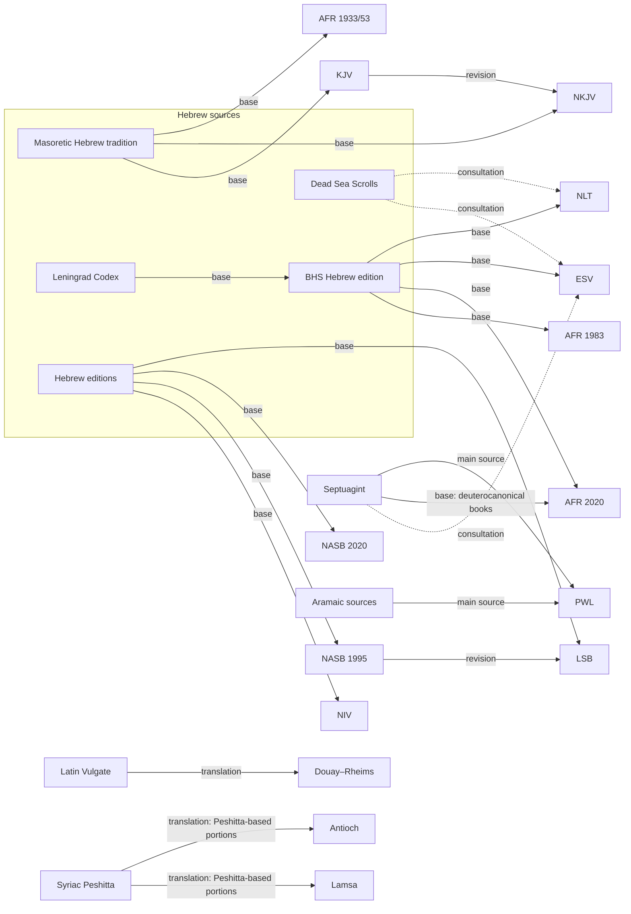
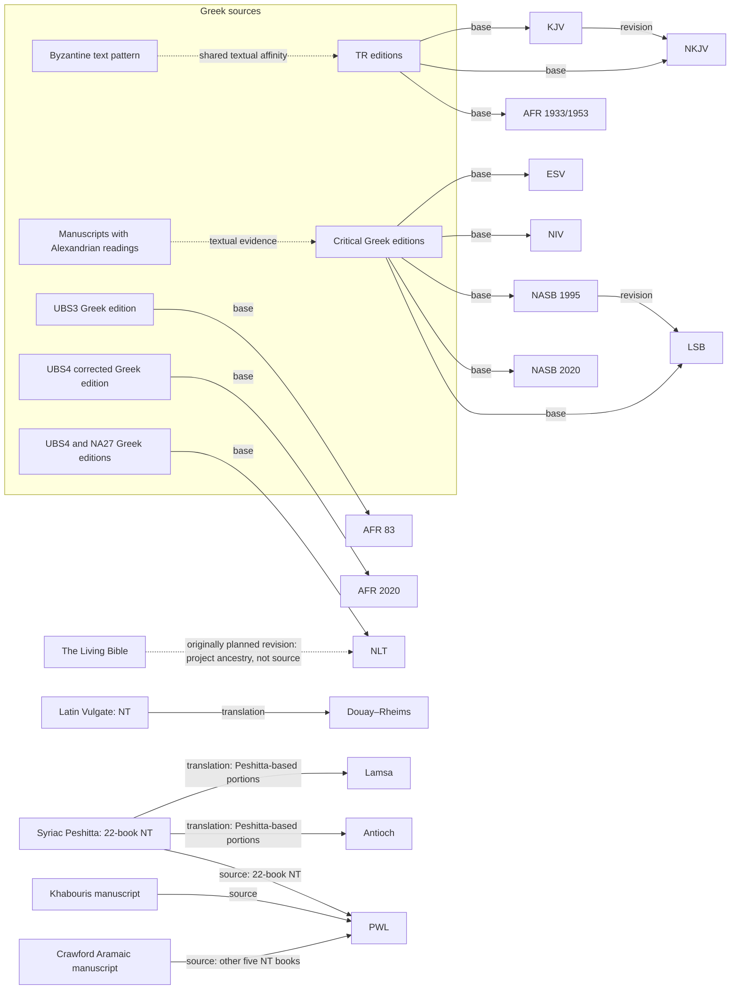

# Bible Source Texts

The Bible reached modern readers through a long history of composition, copying, translation and printing. The source texts behind the English translation traces back in history to the surviving witnesses.

## Materials and Preservation

The fate of the original bible manuscripts is unknown. Wear, moisture, decay, loss and deliberate destruction are plausible causes. Eusebius [reports the destruction of Christian scriptures](https://www.newadvent.org/fathers/250108.htm) during persecution, but does not establish the fate of the autographs. It is possible that the original manuscripts reached the end of it's life after [100 to 200 years of use](https://larryhurtado.wordpress.com/2011/03/31/how-long-were-manuscripts-used/) although storage and environmental [conditions affect survival](https://www.britishmuseum.org/blog/preserving-papyrus-caring-4000-year-old-documents). All surviving manuscripts are replacement copies.

## Chronological Timeline

Dates of composition are estimates and are disputed. The following groups use the ranges in the project's [book dates](../age.md#the-age-of-the-bible), not claims that surviving copies date from the time of composition. Copying dates identify when surviving manuscripts were written, not when their texts were first composed or the manuscripts discovered. Textual traditions, translations and printed editions are distinct from individual manuscript witnesses.

The copying dates of the Khabouris and Crawford manuscripts in the New Testament lineage graph are uncertain and are not established here. Neither should be dated simply by the age of the Syriac textual tradition it represents.

1. **Second millennium BCE, Israelite origins:** The linked estimates place Genesis, Exodus, Leviticus, Numbers and Deuteronomy around 1445 to 1405 BCE, and Joshua around 1405 to 1385 BCE. These books are principally Hebrew compositions.
2. **First millennium BCE, Israelite kingdoms and exile:** The estimates place Judges, Ruth, Samuel, Proverbs and other writings across the monarchy, and prophets including Amos, Hosea, Micah and Isaiah in the eighth and seventh centuries BCE. Jeremiah, Lamentations, Ezekiel and Kings are associated with the later kingdom and exile. Psalms spans a long estimated period.
3. **Sixth to fourth centuries BCE, Persian period:** Daniel, Haggai, Zechariah, Ezra, Chronicles, Esther, Malachi and Nehemiah are among books dated to this period in the linked table. Biblical Aramaic appears in parts of Daniel and Ezra; most of these writings are Hebrew. Other dating models, including later dates for parts of Daniel, differ.
4. **Third to first centuries BCE, Hellenistic period:** The Greek translation of the Torah began around the third century BCE. Other books were translated separately over time, forming part of what is called the [Septuagint](https://tyndalehouse.com/2023/11/09/the-septuagint). Some Jewish writings of this period were composed in Hebrew or Aramaic, others in Greek. Different communities include different books in their biblical collections.
5. **Third century BCE to first century CE, Dead Sea Scrolls:** The scrolls were copied over several centuries, approximately from the third century BCE to the first century CE. They include biblical manuscripts as well as other writings. Their later discovery is noted below; see the [Israel Antiquities Authority](https://www.deadseascrolls.org.il/learn-about-the-scrolls/introduction) for their history and dating.
6. **First century CE, Roman period:** The New Testament books were written in Greek in the early Christian communities. The linked book dates give estimated ranges for the Gospels, Acts, letters and Revelation. Their precise dates and sequence remain debated.
7. **First to fifth centuries CE, early church:** The Syriac Old Testament and New Testament have distinct translation histories. Surviving Syriac New Testament Peshitta manuscripts date from the fifth century; the 22-book collection excludes five books found in many later New Testaments. Its textual history is discussed in the [Gorgias Encyclopedic Dictionary of the Syriac Heritage](https://gedsh.bethmardutho.org/Peshitta). In 303, the Roman emperor Diocletian ordered scriptures burned during persecution, as reported by [Lactantius](https://earlychurchtexts.com/public/lactantius_beginning_of_persecution_under_diocletian.htm). Latin translations circulated before Jerome's work, which became central to the Vulgate tradition.
8. **1008 to 1009 CE, Leningrad Codex:** This Hebrew Bible manuscript was copied in 1008 or 1009 CE. It is the manuscript base of [Biblia Hebraica Stuttgartensia](https://www.die-bibel.de/en/biblia-hebraica-stuttgartensia), a modern printed edition, not the Masoretic tradition itself.
9. **1229, medieval church:** The regional [Council of Toulouse](https://sourcebooks.fordham.edu/basis/toulouse-1229.asp) restricted lay possession of biblical books while allowing specified devotional exceptions.
10. **About 1454 to 1455, printing:** Gutenberg's printed Latin Bible appeared in the mid-fifteenth century, making the reproduction of long texts by movable type increasingly significant.
11. **1516 to 1534, printed Greek and Reformation translations:** Erasmus published a printed Greek New Testament in 1516, before the Reformation conventionally dated from 1517. [He used a small group of late Greek manuscripts and Latin for some gaps in Revelation](https://www.csntm.org/2023/05/03/ask-the-prof-how-many-manuscripts-did-erasmus-use-when-he-published-the-first-critical-edition-of-the-greek-new-testament). Luther's German New Testament appeared in 1522, Tyndale's English New Testament in 1526 and Luther's complete Bible in 1534. [Copies of Tyndale's New Testament were publicly burned in 1526](https://doi.org/10.3366/more.2008.45.3.9).
12. **1546 and 1564, Catholic regulations:** The Council of Trent declared the Latin Vulgate authentic for public use in its [1546 decree](https://www.vatican.va/archive/bible/nova_vulgata/documents/nova-vulgata_appendix_decretum-can-script_lt.html). [Rule IV](https://inq-in-action.ciuhct.org/tridentine-rules-1564-en/) of the [1564 Index rules](https://www.papalencyclicals.net/councils/trent/index.htm), issued under Pius IV, restricted reading vernacular Bibles while providing for permission under specified conditions.
13. **1611, English print:** The King James Version (KJV) appeared in 1611. Later English revisions and new translations consulted different editions and witnesses, as described [below](#popular-english-translations).
14. **1757 to 1758, Catholic regulations:** [A 1757 Congregation decree](https://www.brepolsonline.net/content/journals/10.1484/J.RHE.5.103200) and [the 1758 Index form part of the history of restrictions on vernacular Bibles](https://www.gutenberg.org/files/76682/76682-h/76682-h.htm). A [later account](https://www.papalencyclicals.net/greg16/g16inter.htm) describes a revision concerning permitted vernacular editions. It is a retrospective account, not the text of the 1757 regulation itself.
15. **1947 to 1956, Dead Sea Scrolls:** Scrolls found in caves near the Dead Sea include biblical manuscripts centuries older than previously known medieval Hebrew codices. Their discovery and dating are outlined by the [Israel Antiquities Authority](https://www.deadseascrolls.org.il/learn-about-the-scrolls/introduction).

## Manuscripts and Text Traditions

### Hebrew and Greek Old Testament

The Ketef Hinnom silver inscriptions, usually dated to the late seventh or early sixth century BCE, preserve a priestly blessing related to Numbers 6. They are inscriptions, not complete biblical manuscripts. The [Dead Sea Scrolls](https://www.deadseascrolls.org.il/learn-about-the-scrolls/introduction) are a collection of manuscripts copied in the centuries around the turn of the era, not one manuscript. They provide early witnesses to biblical books and show that Hebrew texts existed in different forms. Many survive only as fragments, however, and the collection does not provide a complete early Bible. The [Great Isaiah Scroll](http://dss.collections.imj.org.il/isaiah) is nearly complete.

The Masoretic Text is a Hebrew textual tradition preserved and annotated by Jewish scribes, not one original manuscript. Its careful transmission provides a substantial basis for comparing and editing the Hebrew Bible, but surviving witnesses differ and do not eliminate the need to consider other textual evidence. The tenth-century Aleppo Codex is older than the Leningrad Codex but incomplete today. The Leningrad Codex, dated 1008/1009 CE, is the oldest complete Hebrew Bible codex and underlies major modern printed Hebrew editions ([Tyndale House](https://tyndalehouse.com/2019/09/06/learn-the-secrets-of-the-leningrad-codex)). A codex is a book made of bound leaves. Its completeness makes it a useful edition base, but it is a medieval copy, not an autograph. Its readings can be compared with earlier and other witnesses.

[Biblia Hebraica Stuttgartensia (BHS)](https://www.die-bibel.de/en/biblia-hebraica-stuttgartensia) is a printed Hebrew edition based on the Leningrad Codex, with notes on alternative readings. Other Hebrew editions are also editorial products, not individual manuscripts. An edition provides a usable text and may record variants, but its base text and editorial choices do not reproduce every surviving witness.

The [Septuagint](https://tyndalehouse.com/2023/11/09/the-septuagint) is a collection of ancient Greek translations, not a single Hebrew manuscript. Its translators worked from Hebrew sources that sometimes differed from the ancestors of the Masoretic Text. Comparing its readings with Hebrew scrolls can help identify older textual forms, though translation choices and the copying history of its Greek manuscripts also cause differences.

The diagrams' generic Hebrew and Aramaic sources are categories, not names of individual manuscripts. Hebrew witnesses and editions can preserve or present readings for comparison; Aramaic sources may likewise provide evidence for particular passages or translations. Their age, completeness and textual relationship cannot be assessed without identifying the specific sources. A translation from another language also cannot be treated as a direct copy of a Hebrew or Aramaic original.

### Greek New Testament

Papyrus P52 preserves a small part of John's Gospel. Its early date is uncertain, as the [John Rylands Library](https://www.library.manchester.ac.uk/rylands/special-collections/a-to-z/detail?mms_id=992983876704001631) explains. The fourth-century [Codex Sinaiticus](https://www.ub.uni-leipzig.de/en/about-us/exhibitions/permanent-exhibition/codex-sinaiticus) contains the complete New Testament. The fourth-century [Codex Vaticanus](https://digi.vatlib.it/view/MSS_Vat.gr.1209) does not preserve a complete New Testament. Neither is an original composition.

*Byzantine* and *Alexandrian* describe broad patterns of Greek readings, not individual manuscripts or perfectly uniform families. Manuscripts with Alexandrian readings include early witnesses such as Sinaiticus and Vaticanus. Their early date and substantial surviving text make them important for comparison, but they differ from one another and neither is an autograph. The Byzantine pattern is widely represented in later Greek manuscripts, providing extensive evidence of transmission, but its witnesses also differ and their number alone does not establish the earliest reading. The [SBL discussion of textual witnesses](https://www.sbl-site.org/assets/pdfs/pubs/067009P-front.pdf) describes the evidence used in editing the Greek New Testament.

The Textus Receptus (TR) is a name for a tradition of printed Greek New Testament editions associated with Erasmus and later editors. It made a Greek text available in print and has a significant history in translation, but it is not identical to every Byzantine manuscript. Erasmus's work drew on a small group of late Greek witnesses; Latin supplied some missing material in Revelation ([CSNTM](https://www.csntm.org/2023/05/03/ask-the-prof-how-many-manuscripts-did-erasmus-use-when-he-published-the-first-critical-edition-of-the-greek-new-testament)).

A modern critical edition compares variant readings from many witnesses to make an edited Greek text. It does not rely only on Sinaiticus and Vaticanus. The Münster institute describes one method for studying relationships among witnesses, the [Coherence-Based Genealogical Method](https://www.uni-muenster.de/INTF/en/forschung/cbgm/index.html). The UBS and Nestle-Aland editions named in the diagram are printed critical editions, not manuscripts. Their edited texts and notes make evidence accessible, but editions and translators can differ in their assessment of readings. Earlier surviving copies can offer valuable evidence, but age alone does not prove a reading is accurate.

### Latin and Syriac

The Latin Vulgate is a translation tradition, associated especially with Jerome, not a replacement for the Hebrew, Aramaic and Greek compositions. Its long use and surviving copies provide evidence of the Latin Bible's history, but its manuscripts and editions have their own copying history. Differences from other witnesses may reflect translation or later transmission rather than a different source text.

The Syriac Peshitta likewise is a translation tradition, not a single manuscript. Its Old Testament and New Testament have distinct histories; surviving New Testament Peshitta manuscripts reach back to the fifth century. They provide early Syriac evidence, but the standard Syriac New Testament Peshitta has 22 books, not all 27. The five absent books are 2 Peter, 2 and 3 John, Jude and Revelation ([Gorgias](https://gedsh.bethmardutho.org/Peshitta)). Later Syriac editions may contain them, but their source should not be assumed. Translation and copying can also introduce differences from other textual witnesses.

The diagram identifies the Khabouris manuscript and the Crawford Aramaic manuscript as sources for [David Bauscher's translation](https://www.lulu.com/shop/david-bauscher/the-peshitta-holy-bible-translated/hardcover/product-24008886.html), with Crawford identified for the five books outside the standard Peshitta New Testament. These are individual manuscript witnesses, not names for the Peshitta as a whole. Their stated role makes them relevant to assessing that translation, but their copying dates, completeness and precise textual relationships are not established here. Claims that either manuscript dates from an early century should not be treated as verified on the age of the Syriac tradition alone. Neither is established here as an original or as a direct ancestor of another named witness.

## Illustrative Text Lineage

The diagrams show selected Old Testament and New Testament source and revision relationships, not every manuscript, edition or translation. Arrow labels distinguish a **base or translation** from **consultation**, **shared textual affinity**, **textual evidence**, **revision** and project ancestry. Revision does not replace use of source texts. No arrow claims that one named surviving witness was copied from another. Details for English translations appear [above](#english-translation-sources); further edition details appear below.

**Old Testament sources**

**New Testament sources**

The [Leningrad Codex is the base of BHS](https://www.die-bibel.de/en/biblia-hebraica-stuttgartensia); the [ESV preface](https://www.esv.org/preface/) identifies BHS as its Old Testament base and describes consultation of the Dead Sea Scrolls and Septuagint. Byzantine readings have an affinity with the TR. Manuscripts containing Alexandrian readings contribute evidence to modern critical Greek editions, but are not their sole basis ([SBL](https://www.sbl-site.org/assets/pdfs/pubs/067009P-front.pdf)).

The Dead Sea Scrolls give translators earlier Hebrew witnesses to compare with the Masoretic tradition and ancient translations. For example, a Dead Sea Scroll reading of Isaiah 53:11 includes “light”, absent from the Masoretic Hebrew text; the reading is discussed in this [account of the scrolls&#39; impact](https://www.logos.com/grow/nook-dead-sea-scrolls-modern-bible-impact/). The NIV reads “he will see the **light** of life” in Isaiah 53:11; its footnote attributes the variant to the Dead Sea Scrolls, and the Septuagint also supports the reading “light”. The words “of life” are an NIV interpretation, not wording from the scroll. For discussion, see [Clark&#39;s study of modern translations of Isaiah](https://translation.bible/wp-content/uploads/2024/06/clark-1984-the-influence-of-the-dead-sea-scrolls-on-modern-translations-of-isaiah.pdf) and this [textual comparison](https://evangelicaltextualcriticism.blogspot.com/2020/04/he-will-see-light-in-isaiah-5311.html). This does not establish that a particular scroll controlled the translators' decision. Where readings differ, a translator may retain the Masoretic reading, choose another reading or report a variant in a note. Discovery of the scrolls did not replace the Masoretic Text or make every later translation use the same reading.

English translations based on Syriac include the multivolume [Antioch Bible](https://www.gorgiaspress.com/antiochbible), [George Lamsa's 1957 Bible](https://gedsh.bethmardutho.org/Lamsa-George) and [David Bauscher's translation](https://www.lulu.com/shop/david-bauscher/the-peshitta-holy-bible-translated/hardcover/product-24008886.html). The five books absent from the 22-book Syriac New Testament Peshitta have a separate textual history; see this [discussion of the Syriac Bible](https://textandcanon.org/the-bible-in-the-language-of-jesus/).

## Popular English Translations

English revision relationships describe literary history, not a substitute for consulting original-language texts. Translators may also compare ancient versions and manuscript variants.

- **Douay-Rheims:** The [preface](https://bible.usccb.org/bible/preface/0) indicate that it was translated from the Vulgate.
- **KJV (1611):** The Old Testament primarily uses the Masoretic Hebrew tradition; the New Testament follows the printed Greek TR tradition. It also revises the English Bishops' Bible.
- **NKJV:** This revision of the KJV uses the Masoretic Hebrew tradition for the Old Testament and retains the TR for the New Testament. Its notes identify critical-text and Majority Text readings ([NKJV preface](https://www.bible-researcher.com/nkjv.html); [preface at Blue Letter Bible](https://www.blueletterbible.org/bibles/preface-to-the-new-king-james-version.cfm)).
- **NASB 1995:** The [Lockman Foundation](https://www.lockman.org/about-nasb-1995/) identifies the 26th Nestle-Aland edition as the Greek text used in most instances.
- **NASB 2020:** Its [source statement](https://www.lockman.org/new-american-standard-bible-nasb/about-nasb-2020/) identifies BHS and Biblia Hebraica Quinta (BHQ) for Hebrew and Nestle-Aland 28 with the Editio Critica Maior (ECM) for Greek.
- **NIV:** Its [preface](https://www.bible-researcher.com/niv2011-preface.html) describes use of Hebrew editions and an eclectic Greek text, meaning a text selected through comparison of witnesses.
- **NLT:** Uses BHS for the Old Testament and UBS4 and NA27 for the New Testament; the Dead Sea Scrolls were consulted for the Old Testament. Its project began as a planned revision of The Living Bible, but that plan does not make The Living Bible its translation base ([Tyndale translation process](https://www.tyndale.com/sites/nlt/translation-process); [Tyndale on translation](https://sites.tyndale.com/tyndalebibles/how-to-translate-a-bible/)).
- **ESV:** Its current [preface](https://www.esv.org/preface/) identifies Biblia Hebraica Stuttgartensia (BHS) and the UBS fifth and Nestle-Aland 28th Greek editions as its primary printed sources.
- **LSB:** The Legacy Standard Bible is based on the NASB 1995, not the 2020 revision. Its [foreword](https://lsbible.org/foreword/) identifies Nestle-Aland 27, with Nestle-Aland 28 for the General Epistles; its [FAQ](https://lsbible.org/faq/is-the-lsb-a-new-translation/) explains its relationship to the NASB.

## Afrikaans Bible Translations

- **AFR53**: is the Afrikaans Bible of 1933/1953; its 1953 edition is a revision of the 1933 edition, not a separate translation. It uses the Masoretic text for the Old Testament and the Textus Receptus (TR) for the New Testament ([Bible Society of South Africa](https://www.biblesa.co.za/resources/about-bible-translation/bible-translations/the-bible-in-afrikaans); [Koers](https://doi.org/10.4102/koers.v21i3.1796)).
- **AFR83**: The Afrikaans Bible of 1983 sourced text from BHS for the Old Testament and UBS3 for the New Testament ([HTS](https://www.scielo.org.za/scielo.php?lng=en&nrm=iso&pid=S0259-94222020000400041&script=sci_arttext); [In die Skriflig](https://indieskriflig.org.za/index.php/skriflig/article/view/2758/7097)).
- **AFR2020**: The Afrikaans Bible of 2020 uses BHS for the Old Testament, the corrected UBS4 for the New Testament and the Septuagint for the deuterocanonical books ([Bible Society introduction](https://www.biblesa.co.za/af/die-bybel-2020-vertaling-inleiding-en-voorwoord); [Tydskrif vir Geesteswetenskappe](https://scielo.org.za/pdf/tvg/v60n4-1/02.pdf); [In die Skriflig](https://indieskriflig.org.za/index.php/skriflig/article/view/2758/7097)).
- **PWL**: According to its [translation account](https://www.padwlewe.org.za/Vertaling.html), PWL uses mainly the Septuagint and Aramaic sources for the Old Testament, and the Peshitta and Khabouris manuscript for the New Testament. For the five books outside the 22-book Peshitta, it uses the Crawford Aramaic manuscript.

## Conclusion

The Bible's [composition and transmission](#chronological-timeline) span many centuries and languages. Its [surviving witnesses and textual traditions](#manuscripts-and-text-traditions) are distinct from the original compositions and from printed editions. [English translations](#popular-english-translations) draw on these sources through different editorial and revision histories.
